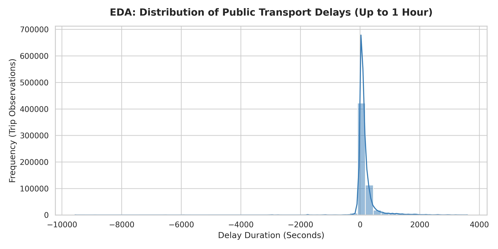
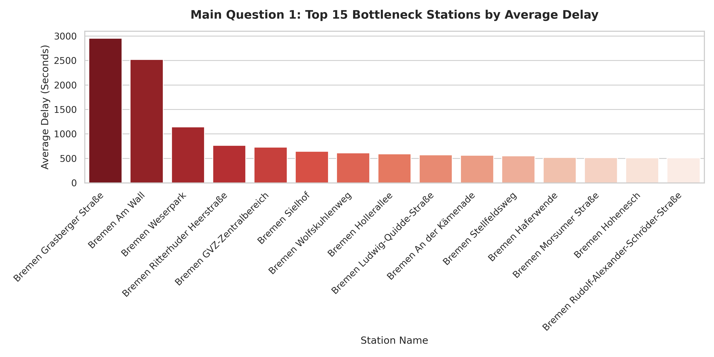
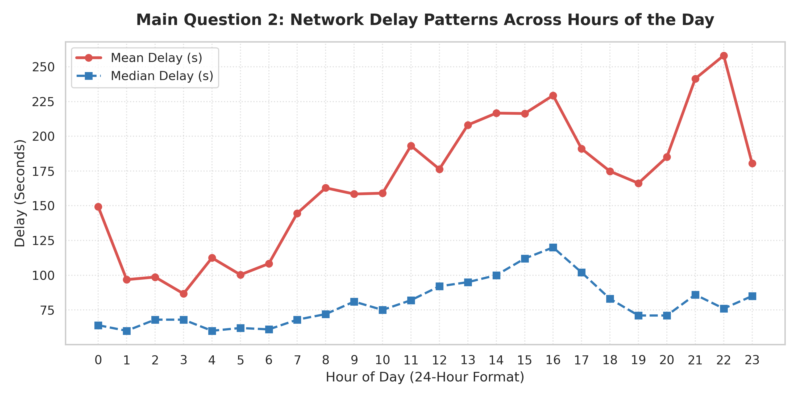

# 🚊 DataStory_Bremen_Transit

An advanced data analytics and digital transformation project analyzing **BSAG and VBN** public transport delay telemetry across the Bremen tram and bus network covering **August 17–31, 2026**.

---

## 👥 Project Team & Contributions

This collaborative project was developed by a three-member team, with responsibilities divided across data engineering, exploratory analysis, and core research questions:

| Team Member | Role & Responsibilities | Focus Area |
| :--- | :--- | :--- |
| **Team Member 1: Nithin Yemparala** | Data Processing & Ingestion Pipeline | Built the high-performance Polars ingestion engine for 4,055 snapshot files, handled schema parsing (`1E` route anomalies), and performed Exploratory Data Analysis (EDA) distribution modeling. |
| **Team Member 2: Mark Koruku** | Main Research Question 1 | Investigated spatial bottleneck hotspots, mapped numerical GTFS IDs using `lookup_table.csv`, and analyzed chronic station-level delays across the network. |
| **Team Member 3: Saikiran Gandhe** | Main Research Question 2 | Analyzed temporal delay trends, computing hourly aggregations (mean vs. median) to evaluate peak commute congestion and network schedule efficiency. |

---

## 🛠️ Data Architecture & Integration Methodology
* **Dataset Source:** Over **4,055 snapshot telemetry CSV files** (`update_data (1).zip`) containing `trip_id`, `stop_id`, `delay_seconds`, and `timestamp_fetched`.
* **Static Reference Enrichment:** Combined dynamic telemetry with **`lookup_table.csv`** (containing 2,365 records with `stop_id`, `stop_name`, `stop_lat`, `stop_lon`, and `route_short_name`). 
* **Join Operation:** Performed a left join on `stop_id` to translate raw numerical database identifiers into human-readable Bremen station names and transit line numbers.

---

## 📊 Dashboard Visualizations & Analysis

### 1. Exploratory Data Analysis (EDA): Delay Distribution

* **What this graph shows:** A distribution histogram and KDE curve representing the frequency of delay durations (ranging from -10,000 to +2,000 seconds) across all snapshot observations.
* **Data insights:** The vast majority of transit observations cluster tightly around the 0-second mark (punctual operations), with a sharp right-skew indicating that when delays occur, they tail off gradually up to 30+ minutes. Negative values capture early arrivals relative to schedule baselines.

---

### 2. Main Question 1: Top 15 Bottleneck Stations (Spatial Hotspots)

* **What this graph shows:** A ranked bar chart illustrating the top 15 chronic bottleneck stations across the BSAG/VBN network, sorted by average delay duration in seconds.
* **Data insights:** Stations like *Bremen Am Wall* and *Bremen Grasberger Straße* experience extreme average delays exceeding 3,000 seconds. By joining telemetry with `lookup_table.csv`, transit planners can instantly isolate specific physical junctions causing system-wide friction.

---

### 3. Main Question 2: Hourly Delay Patterns (Temporal Surge Analysis)

* **What this graph shows:** A dual-line time-series plot comparing mean delay (red line) versus median delay (blue dashed line) across all 24 hours of the day.
* **Data insights:** Delays peak significantly during midday and afternoon rush hours (surging past 200 seconds on average around 14:00–16:00), whereas the median remains stable around 60–100 seconds. This reveals that while off-peak hours run smoothly, specific peak operational windows suffer from severe outlier congestion.

---

## 🎯 Conclusion & Future Recommendations
1. **System Reliability:** Bremen’s transit network maintains high baseline punctuality during early morning and late night hours, but suffers from localized bottleneck compounding at specific hubs (e.g., *Am Wall*).
2. **Operational Intervention:** Municipal transit authorities (BSAG/VBN) can utilize these GTFS-RT telemetry insights to dynamically adjust schedule padding or signal priority at high-delay stations during peak afternoon hours.
3. **Portfolio Value:** Demonstrates how combining Polars streaming pipelines with static GTFS lookups creates an efficient, scalable framework for urban transit analytics.

---

